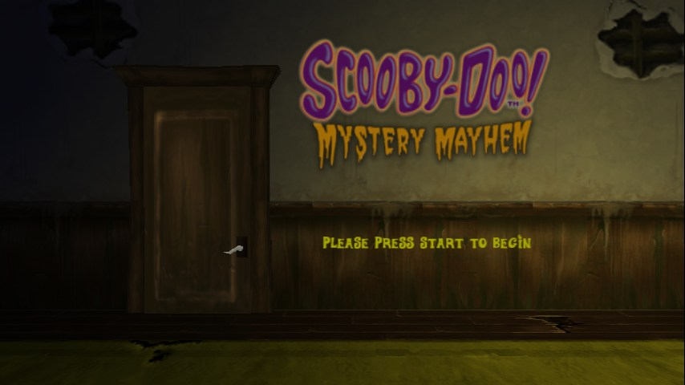
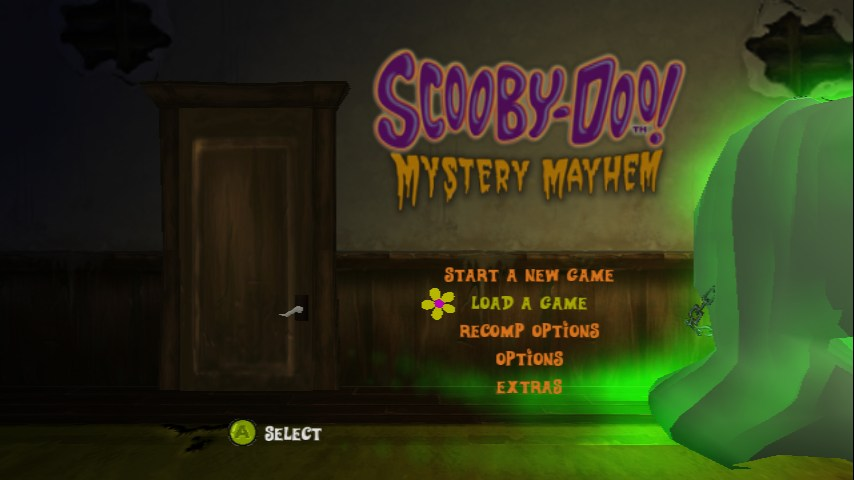
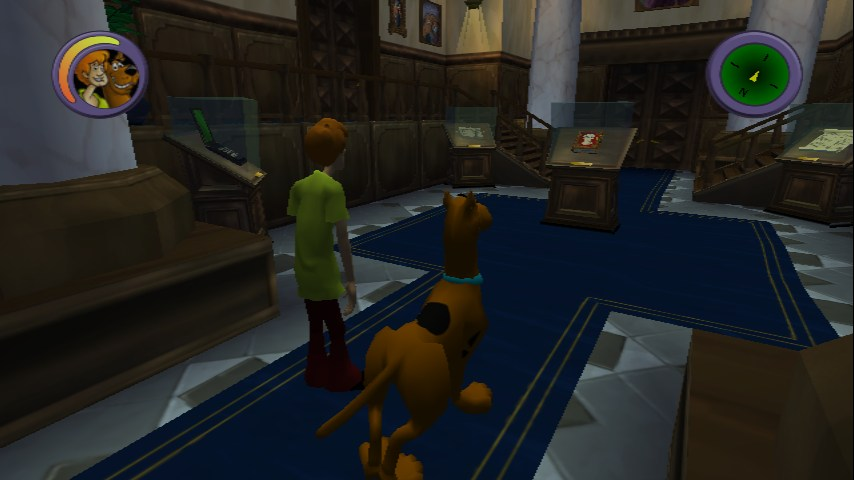
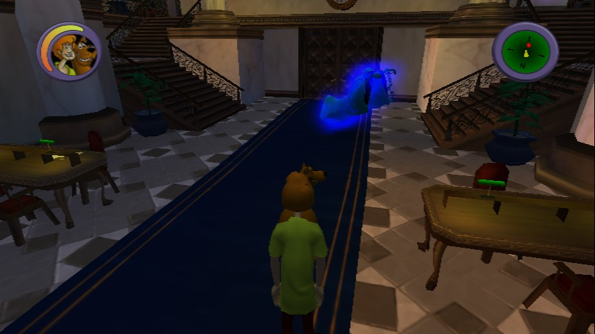

<p align="center">
  
</p>

<h1 align="center">Scooby-Doo! Mystery Mayhem — Static Recompilation</h1>

<p align="center">
  <em>From the creator of the <a href="https://github.com/timftw21/burnout2-recompilation">Burnout 2</a> and <a href="https://github.com/timftw21/smbd-recompilation">Super Monkey Ball Deluxe</a> recompilations.</em>
</p>

An unofficial native version of the original Xbox game for Windows x64, built around accurate gameplay, original presentation, and enhancements. This fan project is independent of THQ and Warner Bros. You must provide your own Xbox game disc image. Original game files are not distributed here.

**0.2.0 is a development release.** Bugs, slowdowns, and stops in untested parts of the game are still possible. Linux and macOS remain planned targets.

## AI disclosure

AI coding assistants, including Anthropic Claude, have assisted with development and research. Changes are checked using native diagnostics, scripted gameplay, and rendering comparisons. Those checks establish specific results, rather than complete game compatibility.

## Screenshots

| Title Screen | Main Menu |
| :---: | :---: |
| [](resources/screenshots/title-screen.jpg) | [](resources/screenshots/main-menu.jpg) |
| **Exploration** | **Ghost Encounter** |
| [](resources/screenshots/library.jpg) | [](resources/screenshots/ghost.jpg) |

## Current status

### Changes in 0.2.0

- **Upscaled HUD** in Recomp Options sharpens HUD, menu, and title artwork with the Real-ESRGAN AI upscaler at 2× internal resolution and above. Results are cached on disk, so artwork seen before is sharp from its first frame.
- **Skip intro movies** in Recomp Options goes straight to the title screen.
- Rebind every Xbox control to a key and a controller input on the new **Controls** page of the settings window.
- **Esc** or the controller **Guide** button now opens the settings window during play, which gains **Restart game** and **Exit game**. Settings that Recomp Options already covers were removed from it, and the Game Files page was redesigned.
- The mouse pointer hides after three seconds without mouse activity during play.

Changes in earlier releases are in the [release notes](https://github.com/timftw21/scoobymm-recompilation/releases).

### Known issues

- The installer is not code-signed, so Windows SmartScreen may warn before it runs. Choose **More info**, then **Run anyway**.
- Your antivirus software may flag the setup executable as a virus. It's a false positive.
- Later episodes have had little testing.
- Other issues that I'm sure I'll find.

### What works

- Startup, opening movies, and the main menus.
- Exploring levels, ghost encounters, and progression into Episode 2 in playtests.
- Keyboard and gamepad input with rumble, pause/resume, and native audio playback, including the Xbox's environmental audio effects.
- Creating and reopening game saves.
- Saved display, refresh-rate, audio, and game-file settings.
- Keyboard and controller remapping.
- Original 4:3 and widescreen 16:9 options; 1×–6× internal resolution, MSAA up to 8×, FXAA, anisotropic filtering up to 16×, and AI-upscaled HUD and menu artwork.
- Refresh limits above the original 30 Hz, including custom rates and Unlimited, with the game clock following real time.
- Frame captures and CPU/GPU performance reports.

### What still needs work

- Testing every episode, Tome of Doom capture, minigame, cutscene, and language mode.
- Wider visual, audio, and gameplay comparisons against the original Xbox release.
- Sustained 360 Hz performance. Selecting a refresh rate does not guarantee the hardware can reach it.
- Linux and macOS ports.

## Getting started

### Windows x64

You need a Direct3D 11-capable graphics card and an XISO image of the **Xbox release of Scooby-Doo! Mystery Mayhem (USA, Europe) (En,Fr,De)**. A full raw-disc dump must first be converted to XISO, for example with extract-xiso. The executable is checked against [the supported-target registry](knowledge/supported_target.json).

**[Download the 0.2.0 Windows installer](https://github.com/timftw21/scoobymm-recompilation/releases/download/v0.2.0/scoobymm-0.2.0-windows-x64-setup.exe)** · [Release notes and SHA-256 checksum](https://github.com/timftw21/scoobymm-recompilation/releases/tag/v0.2.0)

1. Run the installer and select your Xbox XISO image.
2. Choose an installation folder. You can keep a copy of the image with the game and create a desktop shortcut.
3. Choose **Install**. The progress panel shows verification, extraction, and copying as they happen.
4. Choose **Play game**, or launch it later from the Start menu or desktop shortcut.

The installer supplies the compiled game and runtime libraries. It checks your image and prepares the game files automatically. If you leave the image in its original location, keep it available while playing. The default installation is in `%LOCALAPPDATA%\Programs\Scooby-Doo! Mystery Mayhem`.

### Building from source

Install these build prerequisites:

- Visual Studio 2026 C++ build tools and the Windows SDK, including MASM.
- LLVM 22.1 or newer, including `clang-cl`, LLD, and `llvm-rc`.
- CMake 3.24 or newer, Ninja, Git, PowerShell 7 or newer, and Rust with Cargo for the audio processor.

Generation also needs `data/local/default.xbe` from your disc and Ghidra 12.1 analysis maps of it in `data/local/analysis`. The Ghidra export is not yet scripted in this repository, so a fresh clone cannot produce those maps by itself. The installer is the supported way to play.

With those files in place, run from a Visual Studio x64 Developer PowerShell in the source folder:

```powershell
cmake -S . -B build/native-recompiler -G Ninja -DCMAKE_BUILD_TYPE=Release -DCMAKE_C_COMPILER=clang-cl -DCMAKE_CXX_COMPILER=clang-cl
cmake --build build/native-recompiler --target native-recompiler
.\build\native-recompiler\native-recompiler.exe xbe data\local\default.xbe data\local\analysis build\generated --disc 'C:\Games\Scooby-Doo! Mystery Mayhem.xiso.iso'
cmake -S . -B build/xbe-release -G Ninja -DCMAKE_BUILD_TYPE=Release -DCMAKE_C_COMPILER=clang-cl -DCMAKE_CXX_COMPILER=clang-cl -DCMAKE_RC_COMPILER=llvm-rc -DXBOX_GENERATED_SOURCE=build/generated
cmake --build build/xbe-release --target scoobymm
.\Play.cmd
```

Replace the example disc path with your own. Generation verifies the executable and stops on unsupported code paths. Python is not required. In **Game Files**, select your disc image and `data/local/default.xbe`, validate the files, then choose **Play**. `tools\Package.ps1` builds the Windows installer from `build/xbe-release`.

## Game settings

Display, enhancement, and audio settings are in **Recomp Options** on the game's title and pause menus:

- **Display:** Fullscreen, widescreen 16:9, V-sync, and a frame-rate limit up to 480 Hz or unlimited.
- **Enhancements:** 1×–6× internal resolution, supported MSAA levels, FXAA, and anisotropic filtering up to 16×. **Upscaled HUD** sharpens HUD, menu and title artwork with the Real-ESRGAN AI upscaler on your GPU at 2× internal resolution and above. New artwork sharpens moments after it first appears, and artwork from earlier sessions is sharp immediately. **Skip intro movies** starts the next session at the title screen. The defaults reproduce the original Xbox game.
- **Audio:** Master volume, mute, and mute when the window loses focus.

Press **Esc** or the controller **Guide** button to open or close the recompilation's settings window. Preferences save automatically.

- **Game Files:** Select and validate the XISO and executable.
- **General:** Set a custom frame-rate limit up to 1000 Hz, and toggle the frame-rate display.
- **Controls:** Rebind each Xbox control to a key and a controller input.
- **Diagnostics:** Capture a frame or record performance. Both are saved in `build/captures`.

Use **Restore defaults** to reset everything except the game files. During play, **Restart game** starts the game again from its opening and **Exit game** closes it; both ask first, because progress since your last save is lost.

Higher refresh limits draw and update the game more often. The game's clock follows real time, so gameplay speed stays the same.

## Controls

Connected gamepads map directly to the Xbox controller by default. The **Black** and **White** buttons are on the right and left bumpers. To change a binding, open **Controls** in the settings window, select a keyboard or controller cell, and press the new input. A binding already in use swaps places. **Esc** cancels, and **Delete** or right-click clears a binding. **Reset controls** restores the defaults below.

| Xbox control | Default keyboard |
| --- | --- |
| Left stick | W / A / S / D |
| D-pad | Arrow keys |
| A / B / X / Y | Space / Left Shift / E / Q |
| Black / White | R / F |
| Left / right trigger | Z / C |
| Start | Enter |
| Back | Backspace |
| Left / right stick click | Left Ctrl / Right Ctrl |
| Open or close settings | Esc |
| Capture a frame | F8 |
| Start / save performance recording | F9 |

Game input is held neutral while settings are open. **F8**, **F9**, **Esc**, and **Guide** are reserved. To quit, choose **Exit game** in settings. The mouse pointer hides after three seconds without mouse activity during play.

## Saves and updates

Game saves, preferences, and the local storage identity are in `data/user` inside your installation or source folder. **Back up that entire folder, including `storage.key`.** `data/user/hud-cache` keeps up to 512 MB of Upscaled HUD artwork so it is sharp from the first frame in later sessions. You can delete it at any time, and uninstalling removes it.

For installed builds, close the game and run the newer installer using the same installation folder. Updates preserve saves and preferences. Uninstall through Windows **Installed apps**. Saved games, preferences, session reports, and your original disc image are kept. An image copied into the installation folder is removed during uninstall.

## Development and credits

Game code is translated ahead of time into native C++23. Xbox services use native implementations; the game does not run a CPU interpreter. The game's loadable level modules are translated the same way. Analysis, rendering inspection, and diagnostics share the project's native core.

- [Burnout 2 recompilation](https://github.com/timftw21/burnout2-recompilation): Xbox CPU and C++ lowering foundations.
- [Super Monkey Ball Deluxe recompilation](https://github.com/timftw21/smbd-recompilation): XBE reader, offline boot, kernel services, NV2A renderer bridge, and the Windows installer.
- SDL3: windows, controllers, and audio.
- Dear ImGui: settings and diagnostic controls.
- DSP56300 emulator from the xemu project: the Xbox audio effects processor.
- Zydis and Ghidra: offline instruction analysis and generation.
- Direct3D 11 / HLSL: rendering on Windows.
- XboxDev, xemu, and Cxbx-Reloaded: documented system and graphics behavior used as research references.

See [DESIGN.txt](DESIGN.txt), the [research notes](knowledge/), and [THIRD_PARTY_NOTICES.txt](THIRD_PARTY_NOTICES.txt) for requirements, evidence, and dependency notices. Disc images, extracted game assets, generated game sources, saves, and local diagnostics are intentionally excluded from this repository.
